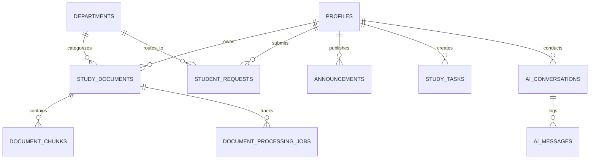

# Student Companion AI — Centralized Drive & Supabase Architecture

> A calm, intelligent academic workspace that helps college students study with AI assistance grounded in their course notes and communicate seamlessly with college management.

---

## 1. Project Overview & Architecture

**Student Companion AI** is a unified full-stack academic platform for college students, faculty staff, and administrators. It features:
- **Centralized Google Drive Storage**: All original study files (syllabi, lecture notes, revision guides) are stored in a single college-controlled Google Drive / Shared Drive. Zero student files are stored in Supabase Storage or on local disks.
- **Supabase PostgreSQL & Auth**: Relational database with full Row-Level Security (RLS) enforcing strict student tenant isolation, department staff ticket triage, and admin governance. Stores document metadata, extracted text chunks, and page numbers.
- **Google Gemini 2.0 AI Assistant**: Accessed exclusively via FastAPI server-side endpoints. Supports grounded document Q&A with interactive, verifiable citations `[Source: Title, Page N]`.
- **Campus Companion React 19 Frontend**: Elegant academic interface with live study document management, real-time chunking status polling, drag-and-drop upload modal, and instant AI reasoning.

---

## 2. Technology Stack

| Layer | Technology | Specification | Architecture Role |
|---|---|---|---|
| **Frontend** | React 19 + Vite | Vite 8.3, React 19.2 | High-performance client, live document library, citation popovers |
| **Icons & Styling** | Lucide React + Vanilla CSS | Custom design system tokens | Academic Indigo & Focus Teal theme, zero bloat, full responsive layout |
| **Backend** | Python + FastAPI | Python 3.11, FastAPI 0.143 | Async REST API, Drive v3 client, document ingestion, Gemini broker |
| **Database** | Supabase (PostgreSQL 15+) | RLS enabled on all 10 tables | Metadata, chunk indexing, profiles, requests, announcements, tasks |
| **File Storage** | Centralized Google Drive | Google Workspace Shared Drive | Secure centralized vault for original document binaries (PDF/TXT) |
| **AI Integration** | Google Gemini API | Server-side (`google-genai`) | Grounded study Q&A, exam question synthesis, syllabus explanations |

---

## 3. Supabase Database Schema

The complete, additive production schema is defined in [20261018_centralized_drive_storage.sql](file:///i:/Richu/Projects/StudentCompanion/backend/migrations/20261018_centralized_drive_storage.sql).

### Relational Entity Model



### Core Tables Summary

1. **`departments`**: Academic divisions (`CSE`, `ECE`, `MECH`, `MATH`, `ADMIN`).
2. **`profiles`**: User profiles linked to `auth.users(id)` with auto-trigger `handle_new_user()`.
3. **`study_documents`**: Central Drive file metadata, checksum SHA-256, page count, chunk count, processing status.
4. **`document_chunks`**: Parsed text chunks preserving exact `page_number` and token count for citation retrieval. Full-text search GIN index enabled.
5. **`document_processing_jobs`**: Job status (`queued`, `running`, `completed`, `failed`), retry counters, and error logs.
6. **`student_requests`**: Grievances, leave requests, bonafide certificates with role-based routing.
7. **`announcements`**: Campus bulletin board with categories and pinned notices.
8. **`study_tasks`**: Daily student task checklists and study goals.
9. **`ai_conversations` & `ai_messages`**: Chat history with JSONB citation metadata.

### Applying the Migration

In your Supabase project dashboard:
1. Open the **SQL Editor**.
2. Click **New Query**.
3. Paste the contents of `backend/migrations/20261018_centralized_drive_storage.sql`.
4. Click **Run**. The script is purely additive with `IF NOT EXISTS` guards.

---

## 4. Quick Start (Windows PowerShell)

### Terminal 1: Backend Setup & Launch

```powershell
# 1. Navigate to backend directory
cd backend

# 2. Activate virtual environment
.\.venv\Scripts\Activate.ps1

# 3. Start FastAPI with Uvicorn
python -m uvicorn main:app --host 127.0.0.1 --port 8000 --reload
```

The backend server runs at `http://localhost:8000`. Interactive Swagger API docs are available at `http://localhost:8000/docs`.

### Terminal 2: Frontend Setup & Launch

```powershell
# 1. Navigate to frontend directory
cd frontend

# 2. Start Vite development server
npm.cmd run dev
```

The web application runs at `http://localhost:5173`.

---

## 5. Running the Test Suite & Quality Verification

Run backend tests:
```powershell
.\backend\.venv\Scripts\python.exe -m pytest backend/tests -v
```
*(7 of 7 tests pass: health, config, extension checking, magic byte PDF validation, upload & chunking lifecycle, and tenant isolation).*

Run frontend linting & production build:
```powershell
cd frontend
npm.cmd run lint   # 0 warnings, 0 errors
npm.cmd run build  # Clean production bundle
```

---

## 6. Security & Privacy Guarantees

1. **Centralized Drive Isolation**: React never communicates with Google Drive directly. Zero Drive tokens or Service Account keys are exposed in client builds.
2. **Drive Scope Minimization**: Service Accounts utilize `https://www.googleapis.com/auth/drive.file`, restricting access exclusively to files created by the application.
3. **5-Layer Upload Validation**: File extension check -> MIME-type sniff -> Magic byte verification (`%PDF-`) -> Max 25MB constraint -> Sanitized filenames.
4. **Tenant Isolation**: RLS ensures students can only read, retrieve, or query their own study documents and chunks.
5. **Prompt Injection Defense**: Document excerpts are wrapped inside `<document_context>` XML tags and strictly treated as reference data rather than executable model instructions.
