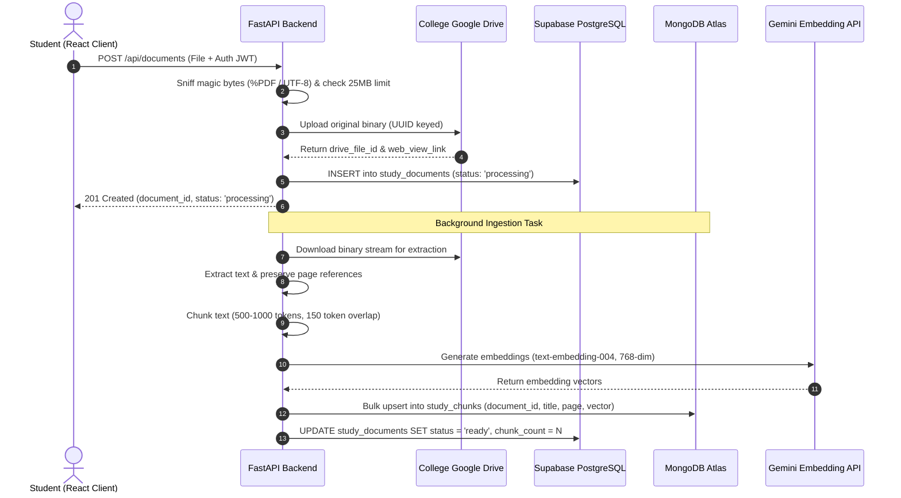
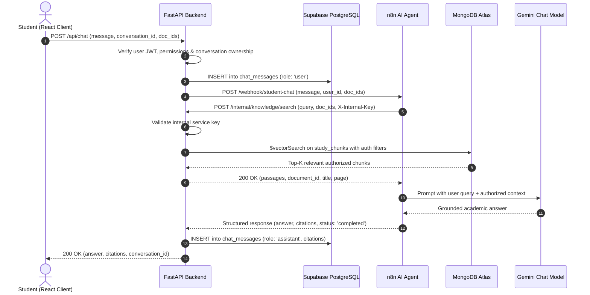

# Student Companion AI — Complete System Architecture
## Centralized Google Drive Storage + MongoDB Atlas Vector Search + n8n AI Agent (Gemini)

---

## 1. Architectural Topology

```
+-----------------------------------------------------------------------------------+
|                                  CLIENT LAYER                                     |
|  React 19 + Vite Frontend SPA (Desktop, Tablet, Mobile)                           |
|  - Manages student sessions via Supabase Auth client                              |
|  - Persistent conversation history & active session drawer                       |
|  - Sends Bearer JWT tokens to FastAPI backend gateway                             |
|  - Markdown rendering & genuine document citation cards with page links           |
|  - Central Google Drive document manager with live processing status badges       |
|  - NEVER accesses MongoDB, n8n, Google Drive, or Gemini directly                  |
+-----------------------------------------------------------------------------------+
                                        |  HTTPS + Bearer JWT
                                        v
+-----------------------------------------------------------------------------------+
|                         FASTAPI BACKEND & SECURITY GATEWAY                        |
|  Python 3.11 + FastAPI Asynchronous REST API (Port 8000)                          |
|  - Auth Middleware: Validates Supabase JWT, resolves user identity, role, dept    |
|  - Security Boundary: Enforces ownership & department-level isolation            |
|  - Ingestion Engine: Validates magic-bytes, uploads to Drive, extracts & chunks   |
|  - Vector Indexer: Generates Gemini embeddings & indexes in MongoDB Atlas         |
|  - Internal Retrieval Service: Exposes POST /internal/knowledge/search to n8n     |
|  - Chat Orchestrator: Invokes n8n Webhook, persists messages & citations         |
+-----------------------------------+-------------------+---------------------------+
        |                           |                   |
        | SQL / PostgREST (RLS)     | Drive API v3      | Private Webhook + Secret
        v                           v                   v
+------------------------+  +-------------------+  +--------------------------------+
|     DATABASE LAYER     |  |   STORAGE LAYER   |  |      AI ORCHESTRATION LAYER    |
|  Supabase PostgreSQL   |  |  Google Drive     |  |  n8n AI Agent Workflow         |
|  - auth.users          |  |  Central Vault    |  |  "Student Companion AI Agent"  |
|  - profiles & roles    |  |  - Original PDF & |  |  - Input Validation & Normal.  |
|  - departments         |  |    TXT files      |  |  - HTTP Request Tool (FastAPI) |
|  - chat_sessions       |  |  - Workspace      |  |  - Google Gemini Chat Model    |
|  - chat_messages       |  |    Shared Drive or|  |  - Memory / Context Framing   |
|  - study_documents     |  |    OAuth user     |  |  - Structured JSON Citations   |
|  - document_proc_jobs  |  |  - UUID keyed     |  +----------------+---------------+
+------------------------+  +-------------------+                   |
                                                                    | Authorized Query
                                                                    v
                                                   +--------------------------------+
                                                   |      SEMANTIC RETRIEVAL        |
                                                   |  MongoDB Atlas Vector Search   |
                                                   |  - Database: student_companion |
                                                   |  - Collection: study_chunks    |
                                                   |  - Index: vector_index         |
                                                   |  - 768-dim Gemini embeddings   |
                                                   |  - Department/active filters   |
                                                   +--------------------------------+
```

---

## 2. Authentication & Trust Boundaries

### 2.1 Identity Flow
1. **User Authentication**: Students, staff, and administrators log in via Supabase Auth (institutional email/password or Google OAuth).
2. **Token Issuance**: Supabase Auth issues a cryptographically signed JWT containing `sub` (User UUID), `email`, and session metadata.
3. **Backend Verification**: On every request to `/api/chat/*` or `/api/documents/*`:
   * FastAPI extracts the token from the `Authorization: Bearer <token>` header.
   * FastAPI verifies the token's signature, expiration, and issuer against the Supabase project configuration.
   * FastAPI resolves the user's operational role (`student`, `staff`, `admin`) and department affiliation from the `profiles` table.
   * If the token is invalid, expired, or the user is suspended, the request immediately terminates with HTTP 401 Unauthorized.

### 2.2 Storage Boundary
* **No Client Credentials**: The React frontend is completely isolated from Google Drive. It possesses no OAuth client secrets, refresh tokens, or service account keys.
* **Server-to-Server Storage Access**: The FastAPI backend communicates with Google Drive using Google API client libraries, authenticated as an institutional Service Account or OAuth 2.0 User.
* **Non-Public Drive Assets**: All files placed in the college Google Drive have their permissions restricted. No public or "anyone with the link" permissions are ever enabled by the system.

### 2.3 Semantic Retrieval & AI Boundary
* **No Direct MongoDB Access**: The browser and n8n never connect directly to MongoDB. All semantic searches are executed through FastAPI (`POST /internal/knowledge/search`).
* **Protected Internal Retrieval Route**: The `/internal/knowledge/search` endpoint requires a shared server-side secret header (`X-Internal-Key`) matching `INTERNAL_SERVICE_SECRET`.
* **Zero Placeholder Embeddings**: Chunks are embedded using Google Gemini `text-embedding-004` (768 dimensions). No placeholder or dummy vectors are ever inserted.

---

## 3. End-to-End Data Flows

### 3.1 Document Ingestion Flow


### 3.2 Chat & Retrieval Flow

